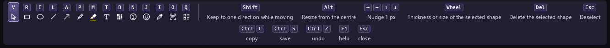

# Duskshot

A screenshot and annotation tool for Windows. Captures go to the clipboard or to a
file you save; Duskshot has no upload feature and needs no installer.


<sub>Background photo: "Alone in the unspoilt wilderness" by David Marcu, CC0, via Wikimedia Commons.</sub>

## Download

Get an exe from the [Releases page](https://github.com/numrii/duskshot/releases/latest)
and run it from any folder you can write to. There are two builds (see
[Builds](#builds)):

- `duskshot-restrictive-<version>.exe`: changes nothing outside its own folder.
- `duskshot-personal-<version>.exe`: adds a few registry-based conveniences.

The exes are built by GitHub Actions from the tagged source and listed in
`SHA256SUMS.txt`. They are not code-signed, so Windows SmartScreen may warn on first
run (More info → Run anyway). To verify a download with the
[GitHub CLI](https://cli.github.com):

```
gh attestation verify duskshot-restrictive-<version>.exe --repo numrii/duskshot
```

## Usage

Duskshot runs in the notification area. Press the capture shortcut or click the tray
icon to capture; right-click the icon for Open image…, Edit clipboard image, Reopen
last capture, Settings and Quit.

The default shortcut is Win+Shift+S, which Windows reserves for the Snipping Tool. If
it doesn't register, pick another shortcut in Settings, or free it in Windows: add `S`
to the string value `DisabledHotkeys` under
`HKCU\Software\Microsoft\Windows\CurrentVersion\Explorer\Advanced` and sign in again.
The personal build has a Settings checkbox that does this (experimental; it also
disables Windows' other Win+S shortcuts and doesn't work on every Windows version).

### Capturing

- Drag to select a region; drag the handles to resize. Shift keeps proportions, Alt
  resizes from the centre, arrow keys nudge.
- Ctrl+click selects a window; hold Ctrl to snap to window and monitor edges.
  Ctrl+A selects the monitor under the cursor.
- Enter or Ctrl+C copies, Ctrl+S saves, Esc cancels.

You can also open a PNG or JPEG in the same editor: drag it onto the exe, pass it on
the command line, or use Open image… / Edit clipboard image in the tray menu.

### Tools



The strip at the top of the capture screen shows each tool and its key, followed by
the keys for the current tool. F1 lists every shortcut.

Besides shapes, pen, highlighter, text, blur, numbered steps and stamps, there is
copy text (OCR, using Windows' built-in text recognition) and a QR code reader. A
handle above the region straightens a photographed document, and the Decoration
button adds a border or drop shadow to the output.

### Settings

Settings covers shortcuts, default colours, theme, save format, folder and file-name
template (`{date}`, `{time}`, `{counter}` and more), and which tools appear in the
toolbar. Off by default: including the mouse cursor, confirming before discarding
annotations, and keeping the last capture in memory for a set time so it can be
reopened.

## Builds

Both builds have the same capture and editing tools, and both register the capture
shortcut as a standard Windows hotkey (no keyboard hook). They differ in what they
write outside their own folder:

| | Restrictive (default) | Personal |
| --- | --- | --- |
| Settings | `duskshot.toml` beside the exe | Same; falls back to `%APPDATA%\Duskshot` if the folder is read-only |
| Registry | Never written | Only when you tick these, under `HKCU`: free a Win+ shortcut, start with Windows, list under Explorer's Open with |
| Logs | None | Only with `--trace` (see [Performance logging](#performance-logging)) |

Neither needs administrator rights. To start the restrictive build with Windows, put a
shortcut to it in `shell:startup`.

## Privacy and security

- Duskshot contains no networking code. eframe's link-opening feature is compiled out;
  the GitHub link in Settings opens in your browser when clicked. Links in QR codes
  are copied, never opened.
- Copied images and text are marked to be excluded from Windows clipboard history
  (Win+V) and cloud clipboard sync.
- The manifest runs it as the current user, never elevated.
- Built with ASLR, DEP, Control Flow Guard and CET shadow-stack compatibility. DLLs
  load only from System32.
- Only the PNG, JPEG and ICO decoders are compiled in.

To check dependencies against RustSec: `cargo install cargo-audit`, then `cargo audit`.

## Building

Requires Windows 10 or 11, [Rust](https://rustup.rs) (stable, MSVC) and Visual Studio
Build Tools with "Desktop development with C++".

```
cargo build --release --locked
cargo build --release --locked --features personal --target-dir target/personal
```

The first builds the restrictive exe into `target\release`, the second the personal
exe into `target\personal\release`. The exe is self-contained.

### Performance logging

Personal and debug builds accept:

- `--trace`: logs memory, CPU, handles and GPU memory to `%TEMP%\duskshot-perf.log`,
  and frame timings to `%TEMP%\duskshot-trace.log`.
- `--trace-cycles <n>`: opens and closes the capture window `n` times, logging each.

`scripts\perf-summary.ps1` summarises the log.

### Releasing

Versions follow `major.minor.patch`. Set the version in `Cargo.toml`, run
`cargo build` to update `Cargo.lock`, commit, then tag and push (`git tag v1.2.3`,
`git push origin main v1.2.3`). The release workflow tests, builds and publishes both
exes with checksums.

## Licence

MIT. See [LICENSE](LICENSE).

[src/emoji_list.txt](src/emoji_list.txt) is generated by
[scripts/emoji_list.py](scripts/emoji_list.py) from Unicode's
[emoji-test.txt](https://unicode.org/Public/emoji/latest/emoji-test.txt) (© Unicode,
Inc., [Unicode License v3](https://www.unicode.org/license.txt)) and GitHub's
[gemoji](https://github.com/github/gemoji) (© GitHub, Inc., MIT).
