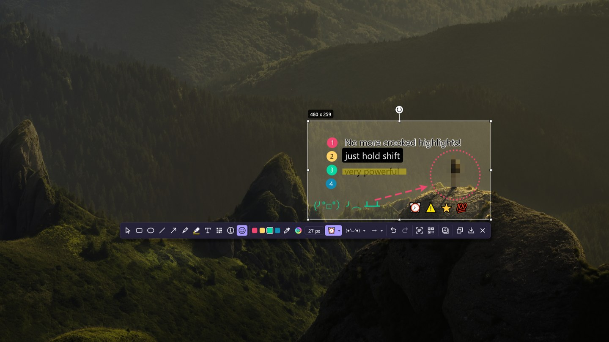

# Darkshot

A privacy-first screenshot and annotation tool for Windows. Captures leave Darkshot
only through the clipboard or a file you choose to save. There is no upload and no
installer, and nothing starts with Windows unless you set it up.



<sub>Background photo: "Alone in the unspoilt wilderness" by David Marcu, CC0, via Wikimedia Commons.</sub>

## Download

Get the latest exe from the [Releases page](https://github.com/numrii/darkshot/releases/latest):

- `darkshot-restrictive-<version>.exe` for work or school computers, or wherever you
  want Darkshot to touch as little as possible.
- `darkshot-personal-<version>.exe` for your own computer.

See [Two builds](#two-builds) for the difference. There is nothing to install: put the
exe in any folder you can write to and run it.

The exes are built on GitHub from the tagged source, and `SHA256SUMS.txt` lists their
checksums. They are not code-signed, so the first time you run one Windows may show
"Windows protected your PC"; choose More info, then Run anyway. To check a download
was built from this repository, run
`gh attestation verify darkshot-restrictive-<version>.exe --repo numrii/darkshot`
with the [GitHub CLI](https://cli.github.com).

## Using Darkshot

Run `darkshot.exe` and it sits in the notification area. Press the capture shortcut
(Win+Shift+S by default) or click the icon to capture; right-click the icon for
Open image…, Edit clipboard image, Reopen last capture, Settings and Quit.

Windows keeps Win+Shift+S for its own Snipping Tool, so Darkshot can register it only
once it is freed in Windows. The personal build has a Settings checkbox for that (see
[Personal](#personal)); otherwise pick another shortcut in Settings if it does not
register.

### Capturing

- Drag to select a region, then move or resize it with the handles. Shift keeps the
  proportions, Alt resizes from the centre, and the arrow keys nudge it.
- Ctrl+click selects a window. Hold Ctrl while drawing, moving or resizing to snap to
  window and monitor edges.
- Ctrl+A selects the whole monitor under the cursor.
- Ctrl+C or Enter copies, Ctrl+S saves, Esc cancels.
- Reopen last capture (off until you turn it on in Settings): after you copy, save or
  close, the capture, region and drawings are kept for a few minutes, in memory only
  and never on disk. Bring them back from the tray menu or with their own shortcut, to
  copy again or fix something. The next capture replaces them, the time you set ends
  them, and they are gone when Darkshot quits.
  While a capture is kept, the capture window is closed completely; only the tray holds
  on to the capture, compressed, in memory: a few MB (5.4 MB for two 2560×1440 screens),
  more for busy or larger screens. Leave the option off if you would rather the tray
  keep nothing between captures; turning it off lets go of a kept capture at once.

### Editing an existing image

Open a PNG or JPEG in the same editor: drag it onto `darkshot.exe`, run
`darkshot.exe picture.png`, or choose Open image… in the tray menu. The personal build
can also add Darkshot to Explorer's Open with menu for PNG and JPEG files. Edit
clipboard image in the tray menu, or its own shortcut if you set one in Settings, opens
whatever image is on the clipboard. The whole image starts selected; crop it by
resizing the region, and Ctrl+A selects all of it again. Save suggests the original name
with `-edited` added, in the same folder and format. Photos are turned the right way up
from their camera data.

An image that fits opens in a window a little larger than itself, in the middle of the
screen; a larger one fills the screen, scaled down to fit. Ctrl+wheel zooms in around
the pointer, dragging with the middle button or with Space held pans, and Ctrl+0 fits
it again. Annotations, copies and saves are always in the image's own pixels.

### Annotating

| Key | Tool |
| --- | --- |
| V | Select and move annotations |
| R | Rectangle |
| E | Ellipse |
| L | Line |
| A | Arrow |
| P | Pen |
| M | Highlighter (Shift for a straight line) |
| T | Text |
| B | Blur: pixelate, Gaussian or solid redaction |
| N | Numbered steps |
| J | Stamp an emoji, kaomoji or symbol: a faded preview follows the pointer, the wheel sizes it, a click places it |
| I | Eyedropper (Shift magnifies to single pixels) |
| O | Copy text: read the text in the region (OCR) |
| Q | Read the QR codes in the region |

The mouse wheel changes thickness, font size, blur strength, step size or stamp size. Ctrl+Z
undoes, Ctrl+Y or Ctrl+Shift+Z redoes, and Delete removes the selected annotation.
With any tool, hold Ctrl and drag a drawing to move it, as with the Select tool;
Ctrl-dragging empty space moves the region. Each tool remembers its own size, so a
large text size does not carry over to the next arrow. While typing a text, Enter
finishes it and Shift+Enter starts a new line.

Right-click backs out one step at a time: it closes an open picker or panel, then
deselects, then puts the tool down (back to Select). It never draws and never closes the
capture.

The emoji stamp has three pickers in the toolbar. The emoji picker has a tab of recent
emoji (it starts with a set of favourites; each emoji you place moves to the front and
pushes the oldest out) and a tab per group, as in Windows' emoji panel, and a search
field that finds emoji by name, by tag, or by the shortcodes Slack, Discord and GitHub
use, such as `joy`, `+1` or `:slightly_smiling_face:`. The kaomoji and symbol pickers
offer a set of each, such as (●'◡'●) or →, drawn in the current colour. Emoji are drawn
from Windows' own emoji font, so the picker shows the ones your Windows has: Windows 11
has newer emoji than Windows 10, and neither has country flags.

Help is on screen as you work. A strip at the top of the screen (or the bottom, when
the region covers the top) shows the keys that do something right now: each tool's
symbol under its key, with the current one lit, then the current tool's own keys and
modifiers. When it would be wider than the screen it wraps onto another row. Beside the
region, a box explains the current tool: what it does, what clicking and dragging do,
its keys and modifiers, and its toolbar options. It moves when you move or redraw the
region, and sits inside it, see-through, when there is no room outside. Settings → Tool
help chooses Off (the default: just the strip), Compact (the box, without the keys and
modifiers the strip already shows) or Full. F1, or ?, shows every shortcut on one
sheet; any key or click closes it. None of this is ever in what you copy or save.

To straighten something photographed at an angle, such as a receipt, drag the round
handle above the region before annotating: the capture turns under the region, which
stays upright, and what you copy or save is the straightened image. It follows the
pointer freely; Shift turns in 15° steps. Right-click the handle to put the capture
back as it was taken.
The handle stays after you start annotating, for small corrections: what you drew stays
where it is, and blur regions blur whatever ends up under them, as shown while you turn.

Copy text (O) and Read QR code (Q) show what they find in a panel, where you can edit
it before copying. Each line of text, or each QR code, is outlined on the capture: click
lines to copy only those, or Shift+click single words. Text that is tilted, sideways or
upside down is read too, which helps with photos of receipts. Both work offline. Text
recognition is the one built into Windows, in the languages you have installed;
anything you blurred or redacted is hidden from it too. Styled QR codes, drawn with
dots, colour or ornaments, are tried several more ways when the plain read fails. Moving
or resizing the region, or turning the capture, with the panel open reads it again. A
link in a QR code is copied as text and never opened. Once you have turned the capture
by hand, Copy text takes the text to be the way up you put it and reads it as it is.

The Decoration button in the toolbar adds a border, a drop shadow or both around the
image when it is copied or saved. The border has its own colour, thickness and line
style (its colour can be see-through), and is shown around the region as you edit;
the shadow appears only in the result. A PNG file keeps the shadow's margin
transparent, and a JPEG file has it on white. Copy puts both on the clipboard:
programs that paste PNG (browsers, Office, chat apps, most image editors) get the
transparent shadow, and the rest (Paint, older programs) get it on white.

### Settings

Settings has the capture shortcut, optional shortcuts for Edit clipboard image and
Reopen last capture, the default colours each capture starts with, a light, dark or
system theme, how much tool help to show, the save format and quality, the default
folder and the file name. Three options are off until you turn them on: including the
mouse cursor in the capture, asking before Esc or Close discards a capture that has
annotations, and keeping the last capture to reopen (for 1 to 60 minutes).
You can also choose the border and shadow each capture starts with (see below). Under Tools you can untick the tools you don't use; they leave the
toolbar and their keys do nothing. Click a tool's key to give it another; Reset beside
it puts its own key back. The file name is a
template that can use `{date}`, `{time}`, `{year}`, `{month}`, `{day}`, `{hour}`,
`{minute}`, `{second}` and `{counter}` (the next number not yet used in the save
folder); hover the `?` beside the field for examples.

#### Keyboard layouts

Shortcuts and tool keys go by the key you press, in whatever keyboard layout you use,
and are shown as printed on your keyboard: on a Swedish keyboard the key right of L
shows as Ö. With AZERTY, Dvorak and other Latin layouts, letters show as the letters
on your keys too.

With a layout that does not use Latin letters, such as Russian (Cyrillic), Greek or
Arabic, letter keys are shown by the Latin letter in that place on a US keyboard: the
key that types Й shows as Q. The key itself is the right one, so pressing Й picks the
tool shown as Q, and a shortcut recorded as Ctrl+Q is pressed with Ctrl+Й. This is
how Windows itself names such shortcuts.

## Two builds

Darkshot comes in two builds from the same source. Both have the same privacy focus
and the same capture and annotation tools; they differ only in how much they touch the
rest of Windows.

Neither build hooks the keyboard or sends key presses of its own: the capture shortcut
is always an ordinary Windows hotkey. That keeps Darkshot clear of the kind of input
anti-cheat software in games looks for.

### Restrictive (the default)

Made to be as unintrusive as possible, so it is still useful on a locked-down work or
school computer, where security software watches for keyboard hooks, registry changes
and programs writing outside their folder:

- The capture shortcut is an ordinary Windows hotkey, registered the standard way. No
  keyboard hook, so nothing that looks like a keylogger.
- Settings are stored only in `darkshot.toml` beside the exe. Nothing is written to the
  registry, `%APPDATA%` or anywhere else.
- No diagnostic log files.
- No administrator rights and no installer: copy the exe into any folder you can write
  to and run it.

The trade-off is that shortcuts Windows keeps for itself, such as Win+Shift+S, cannot
be used unless they are freed in Windows first: add the letter (`S`) to the text value
`DisabledHotkeys` under
`HKEY_CURRENT_USER\Software\Microsoft\Windows\CurrentVersion\Explorer\Advanced`,
then sign out and in again.

### Personal

The same, plus a few conveniences for your own computer:

- **Free a Windows shortcut** (experimental): when the capture shortcut is Win plus a letter or
  digit that Windows keeps for itself (Win+Shift+S), a Settings checkbox frees it by
  adding the letter to your account's `DisabledHotkeys` value in the registry. Windows
  then stops using all its Win+ shortcuts on that letter (for S, also Win+S for
  search). Unticking gives them back, and other letters in the value are left alone.
  It takes effect when Explorer restarts (Settings offers a button) or you sign in
  again. It does not work on every version of Windows; if Windows still keeps the
  shortcut, choose another one, such as Ctrl+Shift+S.
- **Start with Windows**: a Settings checkbox that adds Darkshot to your account's
  startup list in the registry.
- **Open with**: a Settings checkbox that lists Darkshot under Explorer's Open with for
  PNG and JPEG files, through your account's file-type entries in the registry
  (`HKEY_CURRENT_USER\Software\Classes`). It never makes Darkshot the default app, and
  unticking removes the entries.
- Settings fall back to `%APPDATA%\Darkshot` when the exe's folder is read-only.
- An optional diagnostic log (`--trace`) for troubleshooting.

## Build

### Prerequisites

- Windows 10 or 11.
- [Rust](https://rustup.rs) (stable, MSVC toolchain).
- The Microsoft C++ build tools: Visual Studio Build Tools with the
  "Desktop development with C++" workload.

### Restrictive build

From the repository root:

```
cargo build --release --locked
```

The exe is `target\release\darkshot.exe`.

### Personal build

From the repository root:

```
cargo build --release --locked --features personal --target-dir target/personal
```

The exe is `target\personal\release\darkshot.exe`. The separate target folder keeps
both versions side by side. Without `--target-dir`, both builds write
`target\release\darkshot.exe` and the second one replaces the first.

### Using it portably

Copy `darkshot.exe` on its own into a folder you can write to, and run it from there.
It needs no other files. Settings are saved as `darkshot.toml` in the same folder the
first time you save them, so the folder can be moved or copied as a whole.

### Security

- No network code: nothing in Darkshot or its dependencies uploads or downloads. The one
  link, to Darkshot's GitHub page in Settings, is opened by your browser, and only when
  you click it; links found in QR codes are never opened.
- Everything Darkshot copies, images and text, is kept out of Windows' clipboard
  history (Win+V) and cloud clipboard sync: it lives only until the next copy.
- Runs as the signed-in user. Its manifest never asks for administrator rights.
- The exe carries version information naming its build (restrictive or personal), shown
  under Properties → Details.
- Exploit mitigations: ASLR, DEP, Control Flow Guard and CET shadow-stack
  compatibility. DLLs are loaded only from System32, so a DLL placed next to the exe
  is ignored.
- Only the PNG, JPEG and ICO image formats are compiled in.
- Check the dependencies against the RustSec advisory database with
  `cargo install cargo-audit` and then `cargo audit`.

### Starting with Windows

Neither way needs administrator rights, and both affect only your own account.

- **Either build:** press Win+R, type `shell:startup` and press Enter. In the
  folder that opens, right-click, choose New → Shortcut and browse to `darkshot.exe`.
  Delete the shortcut to stop. Darkshot itself changes nothing in Windows.
- **Personal build:** tick "Start Darkshot when I sign in to Windows" in Settings.
  This adds Darkshot to `HKEY_CURRENT_USER\Software\Microsoft\Windows\CurrentVersion\Run`
  and takes effect at once; untick to remove it. If you move the exe, Settings shows
  that the entry points to the old location, and ticking the box again fixes it.

## Versions

Darkshot uses `major.minor.patch` version numbers:

- **major** changes for big changes, such as a reworked interface or settings that
  are no longer compatible;
- **minor** changes for new features;
- **patch** changes for bug fixes.

### Making a release

1. Set the new version in `Cargo.toml` and run `cargo build` so `Cargo.lock` follows.
2. Commit, then tag and push: `git tag v1.2.3` and `git push origin main v1.2.3`.

Pushing the tag starts the release workflow, which tests and builds both versions and
publishes them with their checksums as a GitHub release.

## Licence

MIT. See [LICENSE](LICENSE).

The emoji picker's list, [src/emoji_list.txt](src/emoji_list.txt), is made by
[scripts/emoji_list.py](scripts/emoji_list.py) from Unicode's
[emoji-test.txt](https://unicode.org/Public/emoji/latest/emoji-test.txt) (© Unicode,
Inc., [Unicode License v3](https://www.unicode.org/license.txt)) and the shortcodes and
tags of GitHub's [gemoji](https://github.com/github/gemoji) (© GitHub, Inc., MIT).
