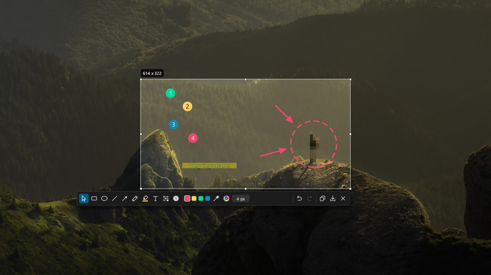

# Darkshot

A privacy-first screenshot and annotation tool for Windows. Captures leave Darkshot
only through the clipboard or a file you choose to save. There is no upload and no
installer, and nothing starts with Windows unless you set it up.



<sub>Background photo: "Alone in the unspoilt wilderness" by David Marcu, CC0, via Wikimedia Commons.</sub>

## Download

Get the latest exe from the [Releases page](https://github.com/numrii/darkshot/releases/latest):

- `darkshot-restrictive-<version>.exe` for work or school computers, or wherever you
  want Darkshot to touch as little as possible.
- `darkshot-personal-<version>.exe` for your own computer.

See [Two builds](#two-builds) for the difference. There is nothing to install: put the
exe in any folder you can write to and run it.

The exes are built on GitHub from the tagged source, and `SHA256SUMS.txt` lists their
checksums. They are not code-signed, so the first time you run one Windows may show
"Windows protected your PC"; choose More info, then Run anyway. To check a download
was built from this repository, run
`gh attestation verify darkshot-restrictive-<version>.exe --repo numrii/darkshot`
with the [GitHub CLI](https://cli.github.com).

## Using Darkshot

Run `darkshot.exe` and it sits in the notification area. Press the capture shortcut
(Win+Shift+S by default) or click the icon to capture; right-click the icon for
Settings and Quit.

Windows keeps Win+Shift+S for its own Snipping Tool, so Darkshot can register it only
once it is freed in Windows. The personal build has a Settings checkbox for that (see
[Personal](#personal)); otherwise pick another shortcut in Settings if it does not
register.

### Capturing

- Drag to select a region, then move or resize it with the handles. Shift keeps the
  proportions, Alt resizes from the centre, and the arrow keys nudge it.
- Ctrl+click selects a window. Hold Ctrl while drawing, moving or resizing to snap to
  window and monitor edges.
- Ctrl+A selects the whole monitor under the cursor.
- Ctrl+C or Enter copies, Ctrl+S saves, Esc cancels.

### Annotating

| Key | Tool |
| --- | --- |
| V | Select and move annotations |
| R | Rectangle |
| E | Ellipse |
| L | Line |
| A | Arrow |
| P | Pen |
| M | Highlighter (Shift for a straight line) |
| T | Text |
| B | Blur: pixelate, Gaussian or solid redaction |
| N | Numbered steps |
| I | Eyedropper (Shift magnifies to single pixels) |

The mouse wheel changes thickness, font size, blur strength or step size. Ctrl+Z
undoes, Ctrl+Y or Ctrl+Shift+Z redoes, and Delete removes the selected annotation.

The Decoration button in the toolbar adds a border, a drop shadow or both around the
image when it is copied or saved. The border has its own colour, thickness and line
style, and is shown around the region as you edit; the shadow appears only in the
result. A PNG file keeps the shadow's margin transparent; the clipboard and JPEG files
get it on white.

### Settings

Settings has the capture shortcut, the default colours each capture starts with, a
light, dark or system theme, the save format and quality, the default folder and the
file name. Two options are off until you turn them on: including the mouse cursor in
the capture, and asking before Esc or Close discards a capture that has annotations.
You can also choose the border and shadow each capture starts with (see below). Under Enabled tools you can untick the tools you don't use; they leave the
toolbar and their keys do nothing. The file name is a
template that can use `{date}`, `{time}`, `{year}`, `{month}`, `{day}`, `{hour}`,
`{minute}`, `{second}` and `{counter}` (the next number not yet used in the save
folder); hover the `?` beside the field for examples.

## Two builds

Darkshot comes in two builds from the same source. Both have the same privacy focus
and the same capture and annotation tools; they differ only in how much they touch the
rest of Windows.

Neither build hooks the keyboard or sends key presses of its own: the capture shortcut
is always an ordinary Windows hotkey. That keeps Darkshot clear of the kind of input
anti-cheat software in games looks for.

### Restrictive (the default)

Made to be as unintrusive as possible, so it is still useful on a locked-down work or
school computer, where security software watches for keyboard hooks, registry changes
and programs writing outside their folder:

- The capture shortcut is an ordinary Windows hotkey, registered the standard way. No
  keyboard hook, so nothing that looks like a keylogger.
- Settings are stored only in `darkshot.toml` beside the exe. Nothing is written to the
  registry, `%APPDATA%` or anywhere else.
- No diagnostic log files.
- No administrator rights and no installer: copy the exe into any folder you can write
  to and run it.

The trade-off is that shortcuts Windows keeps for itself, such as Win+Shift+S, cannot
be used unless they are freed in Windows first: add the letter (`S`) to the text value
`DisabledHotkeys` under
`HKEY_CURRENT_USER\Software\Microsoft\Windows\CurrentVersion\Explorer\Advanced`,
then sign out and in again.

### Personal

The same, plus a few conveniences for your own computer:

- **Free a Windows shortcut** (experimental): when the capture shortcut is Win plus a letter or
  digit that Windows keeps for itself (Win+Shift+S), a Settings checkbox frees it by
  adding the letter to your account's `DisabledHotkeys` value in the registry. Windows
  then stops using all its Win+ shortcuts on that letter (for S, also Win+S for
  search). Unticking gives them back, and other letters in the value are left alone.
  It takes effect when Explorer restarts (Settings offers a button) or you sign in
  again. It does not work on every version of Windows; if Windows still keeps the
  shortcut, choose another one, such as Ctrl+Shift+S.
- **Start with Windows**: a Settings checkbox that adds Darkshot to your account's
  startup list in the registry.
- Settings fall back to `%APPDATA%\Darkshot` when the exe's folder is read-only.
- An optional diagnostic log (`--trace`) for troubleshooting.

## Build

### Prerequisites

- Windows 10 or 11.
- [Rust](https://rustup.rs) (stable, MSVC toolchain).
- The Microsoft C++ build tools: Visual Studio Build Tools with the
  "Desktop development with C++" workload.

### Restrictive build

From the repository root:

```
cargo build --release --locked
```

The exe is `target\release\darkshot.exe`.

### Personal build

From the repository root:

```
cargo build --release --locked --features personal --target-dir target/personal
```

The exe is `target\personal\release\darkshot.exe`. The separate target folder keeps
both versions side by side. Without `--target-dir`, both builds write
`target\release\darkshot.exe` and the second one replaces the first.

### Using it portably

Copy `darkshot.exe` on its own into a folder you can write to, and run it from there.
It needs no other files. Settings are saved as `darkshot.toml` in the same folder the
first time you save them, so the folder can be moved or copied as a whole.

### Security

- No network code: nothing in Darkshot or its dependencies uploads or downloads.
- Runs as the signed-in user. Its manifest never asks for administrator rights.
- The exe carries version information naming its build (restrictive or personal), shown
  under Properties → Details.
- Exploit mitigations: ASLR, DEP, Control Flow Guard and CET shadow-stack
  compatibility. DLLs are loaded only from System32, so a DLL placed next to the exe
  is ignored.
- Only the PNG, JPEG and ICO image formats are compiled in.
- Check the dependencies against the RustSec advisory database with
  `cargo install cargo-audit` and then `cargo audit`.

### Starting with Windows

Neither way needs administrator rights, and both affect only your own account.

- **Either build:** press Win+R, type `shell:startup` and press Enter. In the
  folder that opens, right-click, choose New → Shortcut and browse to `darkshot.exe`.
  Delete the shortcut to stop. Darkshot itself changes nothing in Windows.
- **Personal build:** tick "Start Darkshot when I sign in to Windows" in Settings.
  This adds Darkshot to `HKEY_CURRENT_USER\Software\Microsoft\Windows\CurrentVersion\Run`
  and takes effect at once; untick to remove it. If you move the exe, Settings shows
  that the entry points to the old location, and ticking the box again fixes it.

## Versions

Darkshot uses `major.minor.patch` version numbers:

- **major** changes for big changes, such as a reworked interface or settings that
  are no longer compatible;
- **minor** changes for new features;
- **patch** changes for bug fixes.

### Making a release

1. Set the new version in `Cargo.toml` and run `cargo build` so `Cargo.lock` follows.
2. Commit, then tag and push: `git tag v1.2.3` and `git push origin main v1.2.3`.

Pushing the tag starts the release workflow, which tests and builds both versions and
publishes them with their checksums as a GitHub release.

## Licence

MIT. See [LICENSE](LICENSE).
